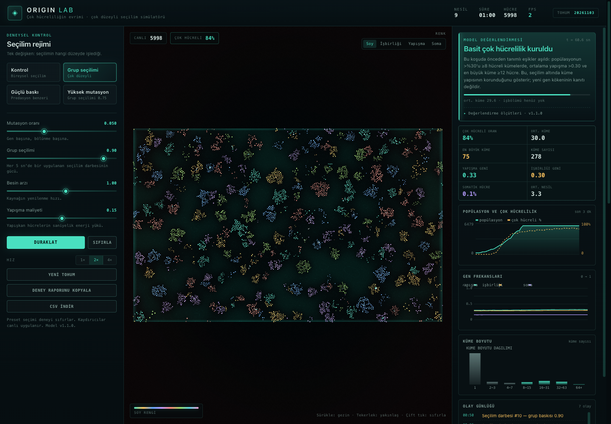

# ORIGIN LAB — Çok Hücreliliğin Evrimi

Rastgele mutasyon ve doğal seçilim altında çok hücreliliğin evrimleşip evrimleşemeyeceğini test eden, WebGL2 ile görselleştirilmiş birey tabanlı bir simülasyon.

**Model sürümü:** `1.3.0` · **Durum:** araştırma amaçlı mekanizma modeli, ampirik kanıt değil.



## Kısa yanıt

Bu çalışma “çok hücrelilik nasıl ortaya çıktı?” sorusunun tüm biyolojik ayrıntılarını değil, **seçilimin hangi düzeyde işlediğinin** bu süreçteki rolünü test eder. Modelde üç kalıtsal özellik vardır: yapışma, işbirliği ve somatik kader. Mutasyon her bölünmede rastgeledir; seçilim ise birey veya küme düzeyinde uygulanabilir.

**Bu modelde ve test edilen parametre aralığında:**

- **Yalnızca bireysel seçilim altında** yapışma ve işbirliği maliyetli olduğu için kümeleşme kalıcı bir popülasyon yapısı haline gelmedi; kontrol koşularında çok hücreli oran ve ortalama yapışma eşiklerin altına düştü.
- **Küme düzeyinde seçilim eklendiğinde** aynı mutasyon havuzundan, aynı soy içinde bağlı büyük hücre kümeleri ortaya çıktı ve 60 saniyelik koşu boyunca korundu.
- **Karmaşık işbölümü** (belirgin soma uzmanlaşması) bu koşullarda ortaya çıkmadı; somatik hücre oranı %1'in altında kaldı. Basit çok hücrelilik ile karmaşık çok hücrelilik aynı problem değildir.

20 eşleştirilmiş tohumda 60. saniye `mcFrac` medyanı kontrolde **0,182**, grup seçiliminde **0,703** oldu; medyan fark **+0,526** (%95 GA +0,511 ile +0,540) ve fark **20/20 tohumda** grup lehineydi (iki yönlü tam işaret-flip p = 1,91 × 10⁻⁶). Bu, model içinde güçlü ve tutarlı bir etkidir; ancak grup seçilimi dışarıdan dayatıldığı için nedensel zincirin tamamını doğada kanıtlamaz.

Yani sonuç koşulsuz bir **“evet”** değil; daha dar bir ifadeyle: **bu modelde basit çok hücreliliğin kalıcı hale gelmesi, küme düzeyinde işleyen seçilime bağlıdır.** Bu, grup seçiliminin doğada genel olarak zorunlu olduğunu veya tek başına yeterli olduğunu **kanıtlamaz**. Model, mevcut varyasyonun kısa vadeli seçilimini test eder; yeni bir genin kökenini veya uzun vadeli karmaşıklık evrimini test etmez.

## Çalıştırma

Derleme adımı yok. Depo kökünde basit bir HTTP sunucusu açın:

```bash
cd /Users/heroglu/Desktop/projects/life
python3 -m http.server 8000
```

Ardından `http://localhost:8000/index.html` adresini WebGL2 destekleyen bir tarayıcıda açın.

> WebGL2 yoksa arayüz bunu algılar ve bir hata mesajı gösterir. Güncel Chrome, Firefox veya Safari önerilir.

## Arayüz

| Öğe | İşlev |
| --- | --- |
| **Kontrol** | Bireysel seçilim; grup seçilimi kapalı (`groupSelection = 0`). |
| **Grup seçilimi** | Her 5 sn'de bir küme düzeyinde ödül/ceza darbesi (`0.90`). |
| **Güçlü baskı** | Predasyon benzeri, daha güçlü grup baskısı (`1.00`) ve hafif yüksek besin. Keşifsel rejim. |
| **Yüksek mutasyon** | Mutasyon `0.14`, grup seçilimi `0.75`. Keşifsel rejim; mutasyon etkisi grup seçiliminden tam olarak izole değildir. |
| **Mutasyon oranı** | Gen başına, bölünme başına mutasyon olasılığı. |
| **Grup seçilimi** | Seçilim darbesinin gücü; canlı uygulanır. |
| **Besin arzı** | Besin alanının yenilenme hızı. |
| **Yapışma maliyeti** | Yapışkan hücrelerin saniyelik enerji yükü. |
| **Renk modları** | Soy, işbirliği, yapışma veya soma özelliğine göre hücre rengi. |
| **Deney raporunu kopyala** | Anlık parametreleri, metriği, olayları, eşikleri ve sonucu metin olarak kopyalar. |
| **CSV indir** | Aynı koşunun makine-okunur özetini, başlangıç değerleri ve eşiklerle birlikte indirir. |

Görünüm: sürükleyerek gezinme, tekerlekle yakınlaşma, çift tıklamayla görünümü sıfırlama. Hücrenin üzerine gelince genotipi ve enerjisi görünür.

## Model kartı

| Alan | Değer |
| --- | --- |
| Model adı | ORIGIN LAB |
| Sürüm | `1.3.0` |
| Amaç | Seçilim düzeyinin basit çok hücreliliğin kalıcılığına etkisini test etmek |
| Dünya | 1800 × 1125 birim, 2B toroidal; en fazla 6.000 hücre |
| Varlıklar | Hücreler; bağlı bileşenler (kümeler) |
| Kalıtsal özellikler | Yapışma (`gAdh`), işbirliği (`gCoop`), somatik kader (`gSoma`) |
| Mutasyon | Bölünme başına gen başına olasılıksal; Gaussian sapma (`σ = 0.12`) |
| Bireysel seçilim | Enerji alımı, metabolik maliyet, bölünme ve ölüm |
| Grup seçilimi | Her 5 sn'de bir dışarıdan uygulanan darbe; ≥8 hücreli kümeler ödül, tek hücre/küçük kümeler ceza |
| Zaman | Sabit adım `dt = 1/60` sn; 60 sn ≈ 3 ortalama nesil (maksimum soy 8–11 nesil) |
| Replikasyon | 20 eşleştirilmiş tohum × 4 rejim × 60 sn (80 koşu) |
| Birincil karşılaştırma | Kontrol vs grup seçilimi; aynı tohumlar, yalnızca `groupSelection` değişir |
| Birincil test | İki yönlü tam işaret-flip permütasyonu, α = 0.05 |
| İkincil rejimler | Güçlü baskı ve yüksek mutasyon; keşifsel, tek değişkenli değil |
| Çıktı | Metin raporu ve tek satırlık CSV |
| **Değil** | Ampirik kanıt, de novo gen kökeni testi, karmaşık işbölümü testi, uzun vadeli evrim modeli |

## Model

### Dünya ve hücreler

- 1800 × 1125 birimlik **2B toroidal** dünya (kenarlar birbirine bağlıdır).
- En fazla **6.000 hücre**; başlangıçta 320 hücre ve 6 soy.
- Besin, 180 × 112 ayrıklaştırılmış bir alanda difüzyon ve yenilenme ile yayılır; hücreler bulundukları noktadan alır.
- Her hücrenin üç kalıtsal özelliği vardır:
  - **Yapışma** (`gAdh`): komşularla bağ kurma ve bağ gücü.
  - **İşbirliği** (`gCoop`): bağlı komşularla enerji paylaşımı.
  - **Somatik kader** (`gSoma`): büyük kümelerde soma hücresine dönüşme eğilimi.

### Bağlar ve kümeler

- İki hücre temas mesafesindeyse, yapışma geni eşiği (`> 0.25`) aşıyorsa ve **aynı soydan** geliyorsa bağ kurulur.
- Bağ sayısı hücre başına yapışma genine göre sınırlıdır (pratikte 2–6 bağ).
- Bağlı hücreler yay benzeri bir kuvvetle bir arada tutulur; küme üyeleri enerji paylaşabilir.
- Kümeler union-find ile her adımda yeniden hesaplanır. “Çok hücreli” sayılmak için eşik **≥ 8 hücre**dir.

### Yaşam döngüsü

- Enerji besinden alınır; bazal metabolizma, yapışma, işbirliği, bağ sayısı ve soma durumu maliyet oluşturur.
- Enerji yeterliyse ve hücre yeterince yaşlıysa bölünür; enerji yavruya paylaştırılır.
- Mutasyon her bölünmede gen başına bağımsız olarak gerçekleşir; etki Gaussian dağılımlıdır (`σ = 0.12`).
- Yaşlılık ve enerji tükenmesi ölüme yol açar. Popülasyon sınırındayken yeni doğum, en düşük enerjili hücreyi değiştirir.
- Bir hücre, küme ≥ 10 hücre olduğunda ve soma geni `> 0.45` ise soma durumuna geçer; bu **geri dönüşsüzdür** ve bölünmeyi durdurur.

### Seçilim rejimleri

**Bireysel seçilim (kontrol).** Grup darbesi yoktur. Yalnızca hücrenin kendi enerjisi ve bölünme başarısı seçilir. Yapışma ve işbirliği maliyetli olduğundan bu rejim, kümeleşmeyi cezalandırır.

**Çok düzeyli seçilim.** Her 5 saniyede bir “seçilim darbesi” uygulanır:

- **≥ 8 hücreli kümeler** enerji kazanır. Ödül; küme boyutu, ortalama yapışma ve ortalama işbirliğinin ağırlıklı bileşimidir.
- **Tek hücreler ve 8'den küçük kümeler** predasyonla olasılıksal olarak elenir.

Bu darbe, Ratcliff ve arkadaşlarının çöktürme seçilimi ile Boraas ve Herron'un predasyon deneylerinin kabaca soyutlanmış halidir. Dışarıdan dayatılan bir “grup fitness”ıdır; biyolojik olarak kendiliğinden ortaya çıkan bir mekanizma değildir.

### Sayısal yöntem

Model sabit adımlı (`dt = 1/60 s`) açık Euler integrasyonu kullanır. Besin difüzyonu `k = min(0.24, 3.6 dt)` ile, hız ise durağan varyansı koruyan ayrık bir Ornstein–Uhlenbeck güncellemesiyle `dt`’ye ölçeklenir. Popülasyon 6.000 hücre sınırındayken doğum, en düşük enerjili hücreyi değiştirir ve ölen hücrenin yuvası aynı adımda yeni yavruya aktarılır. Aynı tohum ve aynı adım sayısı deterministik olarak aynı yörüngeyi üretir. Ayrıntılar: [`docs/ODD.md`](docs/ODD.md) ve [`docs/VALIDATION.md`](docs/VALIDATION.md).

## Değerlendirme ölçütleri

Tüm eşikler `js/config.js` içindeki `VERDICT_THRESHOLDS` nesnesinde tek yerde tanımlıdır. Arayüz, rapor ve CSV aynı değerleri kullanır.

| Durum | Ölçüt |
| --- | --- |
| **Basit çok hücrelilik kuruldu** | `mcFrac > 0.30` **ve** `meanAdh > 0.30` **ve** `maxCluster ≥ 12` |
| **Kümeleşme çöktü** | `mcFrac < 0.25` **ve** `meanAdh < 0.28` |
| **Geriliyor** | “Basit çok hücrelilik kuruldu” koşulu sağlanmışken son 20 sn'de `ΔmcFrac < −0.18` |
| **Geçiş** | Yukarıdakilerin hiçbiri |
| **Tükendi** | `pop < 30` |
| **Değerlendirme zamanı** | `t ≥ 55 sn` |

Bu eşikler **model tasarımıdır, biyolojik yasa değildir**. Özellikle `meanAdh > 0.30` eşiği başlangıç ortalamasına çok yakındır (~0.30). Bu nedenle “kuruldu” sonucu, yapışma geninde büyük bir evrimsel artıştan çok, küme yapısının seçilim altında korunmasını gösterir. Başlangıçtan farka (`Δ`) dair değerler raporda ve CSV'de ayrıca verilir.

## Deney tasarımı

Dört hazır rejim aynı model üzerinde karşılaştırılır:

| Rejim | Mutasyon | Grup seçilimi | Besin | Rol |
| --- | ---: | ---: | ---: | --- |
| Kontrol | 0.05 | 0.00 | 1.00 | Birincil kontrol |
| Grup seçilimi | 0.05 | 0.90 | 1.00 | Birincil müdahale |
| Güçlü baskı | 0.06 | 1.00 | 1.10 | Keşifsel, predasyon benzeri |
| Yüksek mutasyon | 0.14 | 0.75 | 1.00 | Keşifsel, bileşik müdahale |

**Birincil karşılaştırma** kontrol ile grup seçilimi arasındadır: mutasyon, besin ve maliyetler aynıdır; yalnızca `groupSelection` değişir. **Güçlü baskı** ve **yüksek mutasyon** rejimleri keşifseldir; birden fazla parametre değiştiği için tek başına mutasyon veya predasyon etkisi olarak yorumlanmamalıdır.

Her koşu 60 saniyelik simülasyon süresiyle çalıştırıldı. Simülasyon adımı sabittir (`dt = 1/60`); tarayıcı kare hızı simülasyon hızını değiştirmez, yalnızca ekranda akıcılığı etkiler. Aynı tohum ve aynı adım sayısı aynı sonucu verir.

### Replikasyon ve istatistiksel plan

Birincil replikasyon **eşleştirilmiş (paired) tasarımla** çalıştırıldı: aynı 20 tohum dört rejimde de kullanıldı. Tohumlar `500000 + i × 7919`, `i = 0…19` formülüyle üretildi. Bu, başlangıç hücre konumlarını, başlangıç gen değerlerini ve besin alanındaki rastgele yamaları rejimler arasında eşitler; ancak rejimler farklı ölüm/doğum olayları ürettiği için PRNG akışları kısa sürede ayrışır. Bu nedenle tasarım “aynı bireylerin iki rejimde izlenmesi” değil, **ortak başlangıç koşullu bağımsız yörüngeler** olarak yorumlanmalıdır.

- **Birincil sonlanım:** 60. saniyedeki `mcFrac`.
- **Birincil karşılaştırma:** Grup seçilimi − Kontrol.
- **Birincil test:** İki yönlü tam işaret-flip permütasyon testi; `2^20 = 1.048.576` permütasyon; α = 0.05.
- **Etki büyüklüğü:** Medyan eşleştirilmiş fark, %95 bootstrap güven aralığı (10.000 yeniden örnekleme, sabit tohum), Cohen’s dz ve üstünlük olasılığı.
- **Çokluk:** Yalnızca bir birincil test vardır; diğer rejimler, metrikler ve doz-yanıt analizi **keşifseldir** ve çokluk düzeltmesi uygulanmaz.
- **Dışlama:** Önceden tanımlanmış dışlama yoktur; tüm tohumlar analize girer.

Ayrıntılı plan: [`docs/STATISTICS.md`](docs/STATISTICS.md). Model tanımı: [`docs/ODD.md`](docs/ODD.md). Sayısal doğrulama: [`docs/VALIDATION.md`](docs/VALIDATION.md).

Aynı replikasyonu tarayıcı konsolunda yeniden çalıştırmak için:

```js
const rows = await ORIGIN_REPLICATE.run();
ORIGIN_REPLICATE.download(rows);
```

`scripts/replicate.js` varsayılan olarak 4 rejim × 20 eşleştirilmiş tohum × 60 sn çalıştırır ve CSV indirir. Uzun sürebilir; sekme açık kalmalıdır. Başsız Python koşucusu `scripts/headless_replication.py` aynı tasarımı JavaScriptCore ile çalıştırır.

> **Tarihsel pilot:** `v1.1.0` ile yapılan 6 bağımsız tohumluk pilot çalışma `data/replicates.csv` dosyasında saklıdır. Bu pilot, `v1.3.0`’da düzeltilen popülasyon üst sınırı hatasını içerdiği ve tohumlar eşleştirilmediği için **birincil kanıt olarak kullanılmaz**; yalnızca yöntemsel gelişimi belgelemek için tutulur.

## Sonuçlar

### Birincil replikasyon sonuçları

Aşağıdaki tablo, 20 eşleştirilmiş tohumun 60. saniye değerlerini özetler. Ham veri: [`data/replicates_paired.csv`](data/replicates_paired.csv); analiz özeti: [`data/paired_summary.json`](data/paired_summary.json).

| Rejim | n | `mcFrac` medyan [IQR] | `meanAdh` medyan [IQR] | `maxCluster` medyan [IQR] | `somaFrac` medyan [IQR] | Sonuçlar |
| --- | ---: | ---: | ---: | ---: | ---: | --- |
| Kontrol | 20 | 0,182 [0,171–0,195] | 0,232 [0,229–0,237] | 33,5 [30,5–36,2] | 0,0004 [0,0002–0,0004] | 20/20 kümeleşme çöktü |
| Grup seçilimi | 20 | 0,703 [0,697–0,725] | 0,309 [0,306–0,312] | 87,0 [78,2–95,8] | 0,0008 [0,0007–0,0012] | 20/20 basit çok hücrelilik kuruldu |
| Güçlü baskı | 20 | 0,705 [0,694–0,716] | 0,315 [0,311–0,318] | 90,5 [83,8–96,2] | 0,0018 [0,0016–0,0020] | 20/20 basit çok hücrelilik kuruldu |
| Yüksek mutasyon | 20 | 0,628 [0,620–0,643] | 0,301 [0,296–0,306] | 77,0 [67,0–84,2] | 0,0034 [0,0028–0,0039] | 11/20 kuruldu, 9/20 geçiş |

**Birincil sonuç.** Grup seçilimi − kontrol `mcFrac` farkı: medyan **+0,5256**, %95 bootstrap GA **[+0,5112; +0,5405]**, Cohen’s dz **17,83**, üstünlük olasılığı **20/20 = 1,00**, iki yönlü tam işaret-flip **p = 1,91 × 10⁻⁶**. Bu, `n = 20` için ulaşılabilir en küçük iki yönlü p değeridir (`2 / 2^20`); yani testin çözünürlük sınırındadır. Cohen’s dz değeri eşleştirilmiş tasarım ve ortak tohumlar nedeniyle çok büyüktür; biyolojik etki büyüklüğü olarak yorumlanmamalıdır. Asıl bilgi, farkın yönü, medyanı ve güven aralığıdır.

**İkincil metrikler (keşifsel).** Grup seçilimi lehine `meanAdh` farkı +0,0774 [+0,0732; +0,0788], `maxCluster` farkı +53,0 [+49,0; +59,0], `meanCoop` farkı +0,0074 [+0,0034; +0,0090] ve `somaFrac` farkı +0,0005 [+0,0004; +0,0008] bulundu. Bu metrikler birincil sonlanım değildir; ham p değerleri yalnızca keşifseldir.

**Keşifsel rejim karşılaştırmaları.** Güçlü baskı ile grup seçilimi arasında `mcFrac` farkı yoktu (medyan −0,0025 [−0,0204; +0,0102], keşifsel p = 0,273). Yüksek mutasyon rejimi grup seçiliminden daha düşük `mcFrac` üretti (medyan −0,0817 [−0,0862; −0,0710], keşifsel p = 1,0 × 10⁻⁵); ancak bu rejim bileşiktir (mutasyon 0,14 + grup seçilimi 0,75), bu nedenle tek başına “mutasyon etkisi” olarak okunamaz.

### Varsayılan tohumla temsili koşular

Arayüzde preset seçildiğinde çalışan varsayılan tohumların 60 saniyelik başsız (`runHeadless`) sonuçları. Ekran görüntüsü canlı arayüzden alınmıştır; canlı döngünün adım sayısı nedeniyle küçük farklar görülebilir.

| Rejim | Popülasyon | Çok hücreli oran | Ort. yapışma | Ort. işbirliği | En büyük küme | Sonuç |
| --- | ---: | ---: | ---: | ---: | ---: | --- |
| Kontrol | 4.717 | %20,9 | 0,2345 | 0,2891 | 48 | Kümeleşme çöktü |
| Grup seçilimi | 5.974 | %73,0 | 0,3108 | 0,2932 | 84 | Basit çok hücrelilik kuruldu |
| Güçlü baskı | 6.000 | %70,6 | 0,3155 | 0,3010 | 84 | Basit çok hücrelilik kuruldu |
| Yüksek mutasyon | 5.605 | %62,1 | 0,3064 | 0,2958 | 71 | Basit çok hücrelilik kuruldu |

Kontrol rejiminde de geçici kümeler görülür; ancak 60 saniye sonunda hücrelerin yalnızca **%20,9**'u ≥8 hücreli kümelerdeydi ve ortalama yapışma geni 0,2345'e geriledi. Yani “hiç küme yok” değil, **kümeleşme eşiğin altına düştü** ve tek hücreli yaşam baskın hale geldi. Dört temsili koşunun tamamında başarısız doğum sayısı **0**’dır.

### İşbölümü

Somatik hücre oranı tüm varsayılan koşularda **%1'in altında** kaldı (grup seçiliminde %0,10; güçlü baskıda %0,12; yüksek mutasyonda %0,23). Yani modelde **basit çok hücrelilik** kuruldu, fakat **karmaşık işbölümü** evrimleşmedi. Bu ayrım önemlidir: çok hücreliliğin kökeni ile çok hücreli karmaşıklığın kökeni aynı problem değildir. Ayrıca bu modelde soma tek eşikli ve zayıf bir grup yararına sahiptir; bu nedenle sonuç, karmaşık işbölümünün evrilemeyeceğini göstermez.

### Eşik duyarlılığı

Sonuçların yalnızca seçilen eşiklere bağlı olup olmadığını görmek için aynı koşular üç farklı ölçütle yeniden sınıflandırıldı. “Taban” uygulamadaki eşiklerdir; “sıkı” ve “gevşek” alternatiflerdir.

| Rejim | Taban eşikler | Sıkı eşikler | Gevşek eşikler |
| --- | ---: | ---: | ---: |
| Kontrol | 0/20 | 0/20 | 0/20 |
| Grup seçilimi | 20/20 | 0/20 | 20/20 |
| Güçlü baskı | 20/20 | 0/20 | 20/20 |
| Yüksek mutasyon | 11/20 | 0/20 | 20/20 |

- **Taban:** `mcFrac > 0.30`, `meanAdh > 0.30`, `maxCluster ≥ 12`.
- **Sıkı:** `mcFrac > 0.40`, `meanAdh > 0.35`, `maxCluster ≥ 20`.
- **Gevşek:** `mcFrac > 0.20`, `meanAdh > 0.28`, `maxCluster ≥ 8`.

**Kritik uyarı:** Sıkı eşiklerde **hiçbir rejimde “basit çok hücrelilik kuruldu” sonucu yoktur; tüm rejimler 0/20’dir.** Bunun başlıca nedeni, hiçbir koşuda ortalama yapışma geninin 0,35’i aşmamasıdır (en yüksek medyan 0,315). Yani “kuruldu” etiketi, yapışma geninde büyük bir evrimsel artışı değil, **küme yapısının korunmasını** ölçer. Sonuç eşiklere duyarlıdır ve mutlak bir “çok hücrelilik kuruldu” iddiası olarak okunmamalıdır. Buna karşılık kontrol rejiminin tüm eşiklerde 0/20 kalması ve grup seçiliminin taban/gevşek eşiklerde 20/20 olması, eşikten bağımsız olarak yön açısından sağlamdır. Birincil istatistiksel sonlanım kategorik etiket değil, sürekli `mcFrac` farkıdır.

### Doz-yanıt (keşifsel)

Yalnızca `groupSelection` değiştirilerek beş düzeyde, ilk 8 eşleştirilmiş tohumla 60 saniyelik tarama yapıldı. Bu analiz keşifseldir; birincil doğrulayıcı kanıt değildir.

| `groupSelection` | n | `mcFrac` medyan [IQR] | `meanAdh` medyan [IQR] | `maxCluster` medyan [IQR] | Sonuçlar |
| ---: | ---: | ---: | ---: | ---: | --- |
| 0,00 | 8 | 0,187 [0,176–0,201] | 0,233 [0,229–0,237] | 33,0 [30,5–36,2] | 8/8 çöktü |
| 0,25 | 8 | 0,380 [0,359–0,391] | 0,261 [0,260–0,262] | 46,0 [43,5–54,2] | 8/8 geçiş |
| 0,50 | 8 | 0,560 [0,550–0,565] | 0,288 [0,286–0,289] | 59,5 [53,5–69,0] | 8/8 geçiş |
| 0,75 | 8 | 0,676 [0,669–0,686] | 0,307 [0,303–0,308] | 81,5 [75,8–82,0] | 8/8 kuruldu |
| 1,00 | 8 | 0,730 [0,721–0,733] | 0,313 [0,310–0,316] | 95,0 [76,5–109,2] | 8/8 kuruldu |

Tohum içi doğrusal eğim medyanı **+0,551** [`+0,509`; `+0,585`]; 8/8 tohumda pozitif, tam işaret-flip p = **0,0078** (n = 8 için en küçük iki yönlü p). Tohum içi Spearman ρ tüm tohumlarda **+1,000** idi. Yani `groupSelection` arttıkça `mcFrac` monoton olarak arttı. Bu, doz-yanıt ilişkisinin güçlü olduğunu gösterir; ancak tarama yalnızca `groupSelection` üzerinedir ve keşifseldir.

### Yorum

Birincil karşılaştırmada (kontrol vs grup seçilimi) belirleyici değişken mutasyon oranı değil, **seçilimin düzeyi**dir. Aynı mutasyon modeli ve başlangıç dağılımı altında, bireysel seçilim kümeleşmeye karşı çalışırken, küme düzeyinde seçilim kümeleşmeyi destekler. 20 eşleştirilmiş tohumun **20’sinde de** grup seçilimi kontrolden daha yüksek `mcFrac` üretti; medyan fark +0,5256 ve %95 GA [+0,5112; +0,5405] idi. Bu, betimsel olarak tutarlı ve güçlü bir model içi etkidir.

Ancak bu, çok düzeyli seçilimin basit çok hücreliliği kurmak için **genel olarak gerekli ve yeterli** olduğu anlamına gelmez. Grup seçilimi modele dışarıdan dayatılmıştır ve darbe, küme boyutu, yapışma ve işbirliğini doğrudan ödüllendirir; ayrıca tek hücreleri ve küçük kümeleri eler. Bu nedenle sonuç kısmen tasarımın doğal bir sonucudur. Doğru ifade şudur:

> **Bu modelde, test edilen parametre aralığında ve 60 saniyelik koşularda, küme düzeyinde seçilim olmadan basit çok hücrelilik kalıcı olmadı; küme düzeyinde seçilim eklendiğinde ortaya çıktı. Bu, grup seçiliminin doğada zorunlu olduğunu veya tek başına yeterli olduğunu kanıtlamaz; dışarıdan dayatılan bir grup fitness’ı altında dinamiğin nasıl işlediğini gösterir.**

Bu sonucun sınırları:

- 60 sn ≈ 3 ortalama nesildir (maksimum soy 8–11 nesil). Bu, uzun vadeli evrimsel zaman ölçeği değildir.
- Başlangıç popülasyonu yapışma/işbirliği varyasyonu taşır. Model, yeni bir genin **de novo** kökenini değil, mevcut varyasyonun seçilimle düzenlenmesini test eder.
- `meanAdh` eşiği başlangıç ortalamasına yakındır; “kuruldu” sonucu büyük bir genetik artışı garanti etmez. Δ değerleri rapor ve CSV'de verilir.
- Kontrol ile grup seçilimi dışındaki rejimler bileşik müdahalelerdir; tek başına mutasyon veya predasyon etkisi olarak okunmamalıdır.
- `n = 20` eşleştirilmiş tohum, modelin kendi stokastik varyasyonunu örnekler; biyolojik popülasyonlara genelleme yapılamaz. İstatistiksel anlamlılık, biyolojik önem veya ampirik doğrulama değildir.

## Bilimsel dayanak

- **Ratcliff, W. C. et al. (2012).** *Experimental evolution of multicellularity.* PNAS 109, 1595–1600. Maya hücrelerinde çöktürme seçilimiyle 60 günde çok hücreli kümelerin evrimi. [doi:10.1073/pnas.1115323109](https://doi.org/10.1073/pnas.1115323109)
- **Herron, M. D. et al. (2019).** *De novo origins of multicellularity in response to predation.* Scientific Reports 9, 2328. Predasyonun çok hücreliliği tetiklemesi. [doi:10.1038/s41598-019-39558-8](https://doi.org/10.1038/s41598-019-39558-8)
- **Boraas, M. E., Seale, D. B. & Boxhorn, J. E. (1998).** *Phagotrophy by a flagellate selects for colonial prey: a possible origin of multicellularity.* Evolutionary Ecology 12, 153–164. [doi:10.1023/A:1006527528063](https://doi.org/10.1023/A:1006527528063)
- **Hammerschmidt, K. et al. (2014).** *Life cycles, fitness decoupling and the evolution of multicellularity.* Nature 515, 75–79. Yaşam döngüleri ve fitness ayrışması. [doi:10.1038/nature13884](https://doi.org/10.1038/nature13884)
- **Colizzi, E. S., Vroomans, R. M. A. & Merks, R. M. H. (2020).** *Evolution of multicellularity by collective integration of spatial information.* eLife 9, e56349. Uzamsal bilginin kolektif kullanımı. [doi:10.7554/eLife.56349](https://doi.org/10.7554/eLife.56349)
- **Grosberg, R. K. & Strathmann, R. R. (2007).** *The evolution of multicellularity: a minor major transition?* Annu. Rev. Ecol. Evol. Syst. 38, 621–654. [doi:10.1146/annurev.ecolsys.36.102403.114735](https://doi.org/10.1146/annurev.ecolsys.36.102403.114735)
- **Szathmáry, E. & Smith, J. M. (1995).** *The major evolutionary transitions.* Nature 374, 227–232. [doi:10.1038/374227a0](https://doi.org/10.1038/374227a0)

Bu kaynaklar modelin mekanizmalarını esinler; model bu çalışmaların ampirik sonuçlarının yerine geçmez.

## Modelin sınırları

Bu bir **mekanizma deneyi**, ampirik bir kanıt değildir. Sonuçlar aşağıdaki varsayımlara bağlıdır:

- Bağlar yalnızca **aynı soy** içinde kurulur. Bu, bedavacılığı ve sosyal çatışmayı doğal sistemlere göre fazla bastırır; grup seçiliminin işini kolaylaştırır.
- Grup seçilimi dışarıdan, periyodik bir darbe olarak dayatılır. Doğada bu baskı predasyon, çökelme, kaynak dalgalanması veya yaşam döngüsü üzerinden dolaylı işler.
- Darbe, küme boyutu, yapışma ve işbirliğini **doğrudan** ödüllendirir. Bu nedenle “grup seçilimi kümeleşmeyi destekler” sonucu kısmen tasarımın doğal bir sonucudur; model, böyle bir ödül varken dinamiğin nasıl işlediğini gösterir, ödülün doğada nasıl ortaya çıktığını göstermez.
- Darbenin **ödül** ve **ceza** bileşenleri ayrıştırılmadı. Bu veriyle etkinin büyük kümelerin ödüllendirilmesinden mi, küçük kümelerin elenmesinden mi, yoksa ikisinin bileşiminden mi geldiği kesin olarak belirlenemez. Gelecekte reward-only, cull-only ve eşleştirilmiş “sham” ablasyonları gerekir.
- Başlangıç popülasyonu zaten yapışma ve işbirliği genlerinde ayakta varyasyon taşır. Model, yeni bir genin **de novo** kökenini değil, mevcut varyasyonun seçilimle düzenlenmesini test eder.
- 60 saniyelik koşular kısa vadeli bir mekanizma testidir; ≈3 ortalama nesil (maksimum soy 8–11 nesil), uzun vadeli karmaşıklık evrimi için yeterli değildir.
- Soma farklılaşması tek eşikli ve geri dönüşsüzdür; gerçek gelişim programları çok daha karmaşıktır. Soma için güçlü bir grup yararı modellenmediğinden karmaşık işbölümü gerçek anlamda test edilmez.
- Fiziksel kuvvetler, hücre iskeleti, hücre dışı matriks, dokusal gelişim, bağışıklık, uzamsal ekolojik etkileşimler ve gerçek predatörler yoktur.
- Popülasyon 6.000 hücreyle sınırlıdır; sınırdayken yeni doğum en düşük enerjili hücreyi değiştirir. Bu, seçilim rejiminin bir parçasıdır ve sonuçları etkiler.
- “Fitness” burada enerji ve bölünme başarısının bir vekilidir; gerçek uygunluk değildir.
- Değerlendirme eşikleri model tasarımıdır; eşik duyarlılığı tablosu sonuçların hangi ölçüde eşiklere bağlı olduğunu gösterir.

## Doğrulama

`scripts/validate_model.py` ve `scripts/check_project.py` ile yapılan son kontrollerde model sürümü, dondurulmuş eşikler, deterministik tekrar, başlangıç koşulları, popülasyon muhasebesi ve `dt` sağlamlığı doğrulandı. Ayrıntılı rapor: [`docs/VALIDATION.md`](docs/VALIDATION.md).

60 saniyelik `dt` kontrolünde kontrol rejimi `mcFrac` değerleri 1/60, 1/120 ve 1/240 için sırasıyla 0,2092, 0,2001 ve 0,1964; grup seçiliminde 0,7295, 0,7439 ve 0,7470 oldu. `dt` etkisi 1–2 puan mertebesinde kaldı; rejimler arası fark ise yaklaşık 52 puandır. Bu bir formal yakınsama kanıtı değildir, ancak sonucun `dt` seçimine körü körüne bağlı olmadığını gösterir.

**Kritik hata düzeltmesi (v1.3.0).** `v1.2.0`’a kadar popülasyon 6.000 hücre sınırındayken bir doğum, en düşük enerjili hücreyi öldürüyor ancak ölen hücrenin yuvasını aynı adımda yeniden kullanmıyordu. Grup seçilimi tohumu `20261103` için 60 saniyelik koşuda **1.925 başarısız doğum** saptandı; bu, doğum olmadan gerçekleşen ek ölümlere ve şişirilmiş `mcFrac` değerine yol açıyordu. `v1.3.0` ölü yuvaları hemen geri kazanır; aynı koşuda başarısız doğum sayısı **0**’dır. Düzeltilmiş nominal sonuçlar: kontrol `pop = 4.717`, `mcFrac = 0.2092`, `meanAdh = 0.2345`, `maxCluster = 48`, `collapsed`; grup seçilimi `pop = 5.974`, `mcFrac = 0.7295`, `meanAdh = 0.3108`, `maxCluster = 84`, `established`.

Chrome WebGL2 bağlamında yapılan son testte `glError = 0` alındı ve konsol hatası görülmedi. Dört hazır rejim 60 saniyelik koşularla, rapor modalı, CSV çıktısı, masaüstü (1440×1000) ve mobil (390×844) düzenleriyle birlikte doğrulandı. Mobil görünümde yatay taşma yoktur (`scrollWidth = 390`).

## Dosya yapısı

```
index.html                     Arayüz, bilimsel bölüm, literatür
css/style.css                  Karanlık laboratuvar teması ve responsive düzen
js/config.js                   Model sürümü, sabitler, eşikler, hazır rejimler
js/rng.js                      Deterministik PRNG
js/nutrient.js                 Besin alanı: difüzyon, yenilenme, tüketim
js/simulation.js               Birey tabanlı model, seçilim, metrikler, değerlendirme
js/renderer.js                 WebGL2 örneklemeli hücre/bağ çizimi, kamera, seçim
js/charts.js                   Popülasyon, gen ve küme boyutu grafikleri
js/ui.js                       Kontroller, HUD, olay günlüğü, rapor ve CSV
js/main.js                     Başlatma, ana döngü, FPS, hata yakalama
scripts/replicate.js           Tarayıcı konsolu için 4×20 eşleştirilmiş replikasyon
scripts/headless_replication.py  Başsız 80 koşuluk birincil replikasyon
scripts/analyze_paired.py      Eşleştirilmiş istatistikler, tam permütasyon, bootstrap
scripts/sweep_group_selection.py  groupSelection doz-yanıt taraması
scripts/analyze_sweep.py       Doz-yanıt betimsel ve keşifsel analizi
scripts/audit_accounting.py    Birincil grup koşularının popülasyon muhasebesi denetimi
scripts/dt60_check.py          60 saniyelik dt duyarlılık kontrolü
scripts/validate_model.py      Model ve sayısal doğrulama
scripts/check_project.py       Statik bütünlük kontrolleri
docs/ODD.md                    ODD protokolü (v1.3.0)
docs/STATISTICS.md             İstatistiksel analiz planı
docs/VALIDATION.md             Doğrulama ve tekrarlanabilirlik raporu
data/replicates_paired.csv     80 birincil koşunun ham metrikleri (v1.3.0)
data/paired_summary.json       Birincil analiz özeti
data/sweep_group_selection.csv Doz-yanıt ham verisi
data/sweep_summary.json        Doz-yanıt özeti
data/accounting_audit.csv      Grup koşularının doğum/ölüm denetimi
data/accounting_audit.json     Muhasebe denetimi özeti
data/dt60_check.json           60 saniyelik dt duyarlılık sonuçları
data/nominal_runs.csv          Dört varsayılan presetin temsili koşuları
data/nominal_runs.json         Temsili koşu özeti
data/replicates.csv            Tarihsel pilot (v1.1.0, 24 koşu)
assets/origin-lab.png          Arayüz ekran görüntüsü
```
